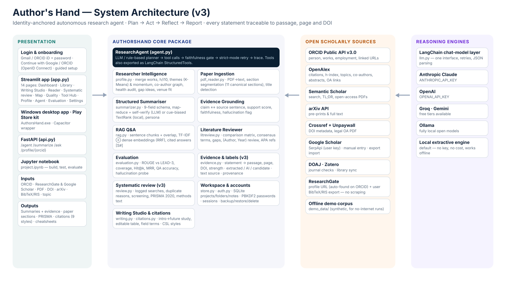

# Author's Hand — AI research companion: from papers to your own manuscript

**IIT Guwahati E&ICT Academy · Generative AI programme · Final Capstone Project, Option 5: *Autonomous AI Research Agent – AI that Summarises Research Papers***

Author's Hand is an autonomous research agent that knows *your* research (ORCID, ResearchGate, Google Scholar) and a workspace that turns the papers you select into material for every section of your own paper. **Every statement can be traced to the passage, page and DOI it came from**, and what was extracted from a paper is always labelled separately from AI-written wording and from candidate ideas.



## What is new in version 3

| Request (user · ChatGPT review · IIT G brief) | What Author's Hand v3 does |
|---|---|
| Good login page; Gmail **or** ORCID iD; sign-up for first-time users; then a personal dashboard | Split welcome/login page: *Sign in* · *Create account* · *Forgot password?* (one-time recovery code). **Continue with Google / Continue with ORCID** (OpenID Connect) once you add free client IDs. "Keep me signed in" for 30 days. Guided setup (discipline, study type, goal, citation style, identities, first project) → dashboard |
| All papers from ORCID / Scholar / ResearchGate with co-authors, type, indexing and citations + refresh | **My Research Profile → 📚 My publications**: one de-duplicated list (type, field, indexing from your Scopus/ABDC/UGC lists, OpenAlex and Scholar citations, co-authors, open access, DOI, source), tick papers → citation in any style, add to a project, Excel/BibTeX/RIS/Word; **🤝 Co-authors** table, chart and network; **🔄 Refresh all** |
| ORCID and Google Scholar don't match | **🔍 ORCID vs Scholar check** tab: numbers side by side, every paper marked *in both / only on Scholar / only on ORCID* (plus year mismatches), why they differ, and downloads to fix them at the source (BibTeX of Scholar-only papers for ORCID import; list of ORCID-only papers for Scholar) |
| ORCID citations / h-index missing (OpenAlex 404) | When OpenAlex has no author record linked to the ORCID iD, papers are found by ORCID-on-paper, DOI and exact title, the OpenAlex author is recognised from them, and missing counts come from Semantic Scholar — so citations, h-index and graphs fill in |
| Pages looked empty for a new account | Your papers are put into your first (empty) project automatically; every page offers **Add my publications**, **Search / DOI / PDF / import** or **Load the example papers**; the Paper Reader lets you **attach the PDF** or **fetch the open-access full text** when only the abstract is stored; Project and Data mode are remembered |
| First page = research profile; photo; dashboard never empty | After sign-in the app opens on **My Research Profile** (photo, name, affiliation, ORCID / Scholar / ResearchGate / LinkedIn links). **Profile photo** upload (or your Google Scholar photo) in Settings. The dashboard shows **My research at a glance** (papers, citations, h-index) and, for an empty project, one-click **Add my publications to this project** |
| Year-wise papers with names and graph; add missing papers manually; citation map that updates on refresh | **📅 Year-wise** tab (papers per year by type, cumulative, citations per publication year, list per year with co-authors); **➕ Add a missing paper…** form (journal, conference, case study, chapter, working paper, report …, *Fill from DOI*, edit/delete); **🗺️ Citation map** of your own papers with *Who cites my papers*, rebuilt by **🔄 Refresh all** |
| LinkedIn and official e-mail verification | LinkedIn profile link + **Continue with LinkedIn** (OpenID Connect); **official e-mail verified with a 6-digit code** (Settings → Profile & identities), then usable for sign-in |
| Google Scholar profile with its numbers and graph | Citations, h-index, i10 (all / since year) and the citations-per-year chart, shown next to ORCID/OpenAlex metrics — always with the source and the date |
| Trace every statement to its evidence | Click any summary or draft statement → source passage with context, section, **page**, **DOI** and support strength (strong / moderate / weak) |
| Separate evidence from suggestions | Labels on everything: **Extracted from the paper** · **AI-generated wording** · **Candidate — verify** (gaps, ideas) |
| Systematic, reproducible literature review | Protocol, **logged searches** (database, query, date, filters, results), duplicate decisions with reasons, editable screening with exclusion reasons, **PRISMA 2020** diagram, methods paragraph, Excel/CSV/JSON export |
| Better PDF handling | Full text vs abstract-only label, page-by-page text viewer, flags for empty/scanned pages and tables/figures, optional OCR, edit the extracted text |
| Wider method coverage, user corrections | "Why detected" table (matched term + sentence), correct the classification, add your field's own terms, editable comparison table |
| Citations & journal checks as verifiable records | Field-level provenance (source, date, *edited by you*), notes/tags kept in BibTeX/RIS; journal signals show data source and date and are explained as a screening aid, not a universal score |
| Privacy and identity | Table of what is stored and what is sent; API keys kept in session memory only; optional ORCID discovery with consent; unlink accounts; backup / restore / delete everything |
| Honest evaluation | Synthetic-data limitation stated everywhere; **real-paper protocol** (abstract as reference vs LEAD-3, failure cases) and **human ratings** built in |
| Accessibility, more users | Text size and high-contrast settings, keyboard use, labels beyond emoji; source types (article, chapter, thesis, report, dataset, preprint, grey literature) |
| Downloadable app | Windows desktop app (`AuthorsHand-Windows.zip`) and a Play Store kit (`mobile/`) |

## IIT Guwahati deliverables

| Required | File |
|---|---|
| Notebook: problem statement, step-by-step code, testing/evaluation, final results | `project.ipynb` (executed; Part C covers v3) |
| Deployed app (Streamlit / FastAPI) | `app.py` (Streamlit, 14 pages) and `api.py` (FastAPI) |
| Report: overview, architecture diagram, workflow, results with screenshots, challenges & future work | `report.pdf` and `report.pptx` (43 slides) |
| Dependencies | `requirements.txt` (and `requirements-desktop.txt` for the Windows app) |
| Instructions | this `README.md` |

**Course link:** prompting and structured output (summaries, Writing Studio) · LangChain chat-model and tool abstractions · embeddings, retrieval and RAG (paper chat, grounding) · autonomous agents with planning and tool use · evaluating generative output (ROUGE, baselines, faithfulness, human ratings) · deployment.
**Personal contribution (Dr. Kameswari Jada):** **Problem & requirements:** Chose Option 5 and defined the features: ORCID / ResearchGate / Google Scholar linking, multi-paper summaries, section-wise writing tabs, full citations in all styles, cheatsheets, projects & folders, login, the app name and a Windows app. **Design decisions:** Reviewed the external (ChatGPT) review and chose what to adopt: evidence tracing, extracted-vs-AI labels, a systematic-review workflow, privacy controls and honest evaluation. **Testing on my own profile:** Tested the app with my own ORCID and Google Scholar profiles; found and got fixed the missing OpenAlex citations (no author record linked to my ORCID), the ORCID–Scholar mismatch, sample numbers on my profile and empty pages for a new account. **Results & limitations:** Judged the outputs against my own papers; the reported scores come from a small synthetic corpus, so a real-paper study with human ratings is the next step. **AI-assistance disclosure:** code and text were drafted with an AI assistant (Claude), then reviewed, tested and refined by me.

## Feature status — how each part works and how it was tested

| Feature | How it works | Tested |
|---|---|---|
| Sign up / sign in with Gmail or ORCID iD + password, recovery code, remember-me, sign out | Built in | Automated tests + browser end-to-end test |
| Continue with Google / ORCID | Live (OpenID Connect via `st.login`) | Needs your own client IDs — not testable without them |
| Projects, folders, notes, tags, backup / restore / delete | Built in | Automated tests |
| Summaries with evidence (passage, section, page, DOI, strength) and labels | Built in | Tested on demo corpus |
| Writing Studio (intro → future study), comparison table, corrections, field terms | Built in | Tested on demo corpus |
| Systematic review + PRISMA | Built in; searches use live APIs | Tested offline; live databases need a network test |
| Citations (9 styles + CSL via DOI), Word/BibTeX/RIS/EndNote | Built in + live doi.org | Built-in styles tested |
| ORCID, OpenAlex, Semantic Scholar, arXiv, Crossref, Unpaywall, DOAJ, Zotero | Live API | Parsers tested on documented response formats; run once in Live mode |
| Google Scholar | SerpApi (your key) · manual entry · export import | Parser tested; SerpApi needs your key |
| ResearchGate, Litmaps, ResearchRabbit, Mendeley, EndNote | File exchange (BibTeX/RIS) + profile links | Import/export tested |
| SciSpace, JANE, Elicit, Consensus, scite … (45 add-ins) | Open pre-filled / open tool | Links only — these tools have no public API |
| OCR for scanned PDFs | Optional package (`rapidocr-onnxruntime`, `pypdfium2`) | Not installed by default |
| Windows desktop app | Go launcher + managed Python | Built here; please test on your PC |
| Play Store app | Capacitor wrapper of the hosted app | Requires hosting + Android Studio + Play Console |

---

## Windows desktop app (easiest)
`AuthorsHand-Windows.zip` is a portable desktop app — no Python or commands needed.
1. Right-click the zip → **Extract All** → **Extract**.
2. Open the folder → double-click **AuthorsHand.exe** (if Windows says *"Windows protected your PC"*: **More info → Run anyway**).
3. First start only: a setup window installs a private Python and the libraries (2–6 min, internet needed).
4. Author's Hand opens in its own window on the **login page**; a Desktop and Start-menu shortcut is created. Your data is saved in `Documents\AuthorsHand\workspace.db` (an older ScholarPilot workspace is moved there automatically).
5. If something breaks, double-click **Repair AuthorsHand.cmd**.

To rebuild: `bash desktop/build_desktop.sh windows` (needs Go) → `desktop/dist/AuthorsHand-Windows.zip`.

## How to run from source
1. Install **Python 3.10+**, unzip `Final_Capstone_Project.zip`, open a terminal in the folder.
2. Windows: `python -m venv .venv` then `.venv\Scripts\activate` · macOS/Linux: `python3 -m venv .venv` then `source .venv/bin/activate`.
3. `pip install -r requirements.txt`
4. `streamlit run app.py` → the browser opens at `http://localhost:8501`.

## First tour
1. **Login page → Explore the demo workspace (no sign-up)** — offline, synthetic example data.
2. **Dashboard** → **Refresh now** → a new paper appears under 🔔 → choose a folder → **Add**.
3. **Library & folders** → tick 3–5 articles → **Open in Writing Studio**.
4. **Writing Studio** → *Summaries*: open a paper card → **Evidence for each summary point** → click a row to see passage, page and DOI. Walk through the tabs; turn **Visual mode** on/off; copy with the icon at the top-right of each grey box.
5. **Paper Reader** → *Evidence*, *Extracted text* (page viewer), *Citation & record* (all styles, field sources, edit the record), *Notes & rating*.
6. **Systematic review** → *Protocol* → *Search & log* → **Run and log search** → *Screening* (decide, give reasons, **Save**) → *PRISMA flow* → *Export*.
7. **My Research Profile** → **🔄 Refresh all**; **📚 My publications** (tick a paper → its citation); **🤝 Co-authors**; **📈 Metrics & graphs** (Google Scholar table and graph, ORCID/OpenAlex metrics, profile health); **🔗 Link & import** (Scholar / ResearchGate exports).
8. **Settings & privacy** → *Privacy* table, *Your data* (backup/restore/delete), *Accessibility*.
9. **Sign out** (bottom of the sidebar).

## Use it for your own research
1. Login page → **Create account** → name, Gmail, (optional) ORCID iD, password twice → tick the privacy note → **Create account** → **save the recovery code** → continue.
2. Guided setup: discipline, study type, goal, style, field terms, ORCID / ResearchGate / Google Scholar links, first project → **Finish setup**.
3. Sidebar → **Data mode: Live (internet)**.
4. **Library → Add articles**: search online, DOI/arXiv, upload PDFs, import BibTeX/RIS (Litmaps, ResearchRabbit, Zotero, Mendeley, ResearchGate, Scopus, WoS) or your ORCID works.
5. Optional AI engine: sidebar → **AI engine** → provider + key (kept only for this session). Groq and Gemini have free tiers; Ollama runs locally. The free local engine sends no text anywhere.

### Google Scholar numbers and graph
Google Scholar has no public API and does not allow scraping. In **My Research Profile → 🔗 Link & import → Google Scholar** choose:
* **Copy & paste my Scholar page (easiest)** — open your Scholar profile → *SHOW MORE* until all articles show → **Ctrl+A**, **Ctrl+C** → paste in the box → **Read my numbers** → check → **Save my Google Scholar numbers**.
* **Automatic (SerpApi key)** — free account at serpapi.com → copy the API key → paste → **Fetch from Google Scholar**.
* **Enter my numbers** — copy citations / h-index / i10 and the per-year counts from your Scholar page.
* **Import my Scholar articles** — Scholar → your profile → select all → *Export* → BibTeX → upload.

### Verify your official e-mail
1. **Settings & privacy → Sign-in providers → E-mail for verification codes**: server `smtp.gmail.com`, port `587`, a Gmail address and its *app password* (myaccount.google.com → Security → 2-Step Verification → App passwords) → **Save e-mail settings** → **Send test e-mail**.
2. **Settings & privacy → Profile & identities → Official e-mail** → type your institutional address → **Send code** → type the 6-digit code → **Verify**. The sidebar then shows *✔ official e-mail* and you can sign in with that address.

### Turn on "Continue with Google / ORCID / LinkedIn"
**Settings & privacy → Sign-in providers** shows the exact steps and redirect address (`http://localhost:8501/oauth2callback`; desktop app: `http://localhost:8765/oauth2callback`).
* **Google:** console.cloud.google.com → new project → *APIs & Services → OAuth consent screen* (External, add yourself as a test user) → *Credentials → Create credentials → OAuth client ID → Web application* → add the redirect URI → copy Client ID and secret.
* **ORCID:** orcid.org → your name → *Developer tools* → register for the free Public API → add the redirect URI → copy Client ID and secret.
* **LinkedIn:** linkedin.com/developers → *Create app* (linked to a company page, e.g. your institution's) → *Products* → **Sign In with LinkedIn using OpenID Connect** → *Auth* → add the redirect URL → copy Client ID and secret. LinkedIn only shares your name and verified e-mail; it does not let apps read connections or publications.
* Paste them in the form → **Save sign-in settings** → close and reopen the app.

**ResearchGate export:** profile → *Research* → select publications → *Download citation* → BibTeX/RIS → Library import.
**Litmaps:** export your map as BibTeX/RIS → Library import; to send a project to Litmaps use *Tool Hub → BibTeX* → Litmaps → *Import*.
**Zotero:** zotero.org → Settings → Security → *Create new private key* (allow write) → *Tool Hub → Zotero*.

> **Academic integrity:** drafts are scaffolds built from the selected papers and always cited. With the local engine they reuse source sentences — paraphrase in your own words and check every statement marked *AI-generated wording* or *Candidate — verify*.

### Background refresh
The dashboard refreshes due projects in the background while the app is open. For scheduled refresh: `python -m authorshand.refresh you@university.edu` (Windows Task Scheduler or cron).

## Phone app / Google Play Store
See `mobile/PLAY_STORE_GUIDE.md` (also **Install app** inside Author's Hand). In short:
1. Host the app online (Streamlit Community Cloud, or the `Dockerfile` on Render / Railway / Cloud Run with a persistent disk at `/data`).
2. Any phone: open the URL → browser menu → **Add to Home screen**.
3. Play Store: put your URL in `mobile/capacitor.config.json` → `npm install` → `npx cap add android` → `npx cap open android` → Android Studio *Build → Generate Signed App Bundle* → Google Play Console (US$25 one-time; new personal accounts need a closed test with 12 testers for 14 days) → upload the `.aab`.
Google blocks its sign-in page inside app WebViews, so in the phone app use e-mail/ORCID iD + password or *Continue with ORCID*.

## Notebook, API, tests
* `jupyter notebook project.ipynb` → *Restart & Run All* (offline; set `LIVE = True` in section 13 for real APIs).
* `uvicorn api:app --reload` → `http://127.0.0.1:8000/docs`.
* `pytest -q tests` → 38 tests.

## Results
> ⚠️ **Limitation.** The numbers below come from **5 synthetic papers written for testing**. They show the pipeline works; they do **not** measure quality on real literature. Use **Evaluation → Your real papers** (abstract-as-reference vs LEAD-3, with failure cases) and **Human ratings** on your own PDFs.

| Metric (synthetic corpus, local engine) | Author's Hand | Note |
|---|---|---|
| ROUGE-1 / ROUGE-L | 0.506 / 0.342 | LEAD-3 baseline: 0.432 / 0.288 |
| ROUGE-2 | 0.226 | LEAD-3: 0.262 (summary-like abstracts) |
| Structured-field coverage | 100% | 9 fields per paper |
| Retrieval Hit@3 / MRR | 100% / 0.87 | 10 QA pairs |
| QA answer accuracy | 90% | one neighbouring-sentence error |
| Hallucination probe | flagged | invented claim support 0.03 vs 1.00 |
| Unit tests | 38 / 38 pass | |

Failure case found by the real-paper protocol on the demo PDFs: *future work* was not detected when a paper has no explicit future-work sentences — reported, not hidden.

## Privacy
Everything (account, projects, papers, notes) is stored in one local database file (`Documents\AuthorsHand\workspace.db` on Windows desktop; `~/.authorshand/workspace.db` or `AUTHORSHAND_DB` otherwise). Passwords are stored only as salted PBKDF2-SHA256 hashes; remember-me tokens only as hashes. API keys stay in session memory. The full table is in **Settings & privacy → Privacy**.

## Folder contents
```
Final_Capstone_Project/
├── project.ipynb            ← executed notebook (Parts A–C, testing, results)
├── app.py                   ← Streamlit app (login → onboarding → 14 pages)
├── ui/                      ← login, dashboard/library, studio/reader, review, tools, settings, about
├── api.py                   ← FastAPI REST API
├── report.pdf / report.pptx ← project report
├── requirements.txt · requirements-desktop.txt · Dockerfile · README.md
├── authorshand/             ← core package
│   ├── auth.py              ← accounts, passwords, sessions, Google/ORCID OIDC
│   ├── evidence.py          ← evidence tracing, labels, text source, provenance
│   ├── review.py            ← systematic review, PRISMA
│   ├── gscholar.py          ← Google Scholar metrics (SerpApi / manual / import)
│   ├── store.py             ← SQLite workspace
│   ├── agent.py · summarizer.py · rag.py · writing.py · citations.py · litreview.py · profile.py
│   ├── connectors.py · journal_quality.py · tools_hub.py · citation_map.py · refresh.py · cheatsheet.py
│   └── evaluation.py · pdf_reader.py · exporters.py · llm.py
├── desktop/                 ← Windows app launcher and build script
├── mobile/                  ← Play Store kit + PLAY_STORE_GUIDE.md
├── demo_data/               ← SYNTHETIC demo papers, profile, journals (labelled, not real)
├── tests/                   ← 38 pytest tests
├── docs/                    ← diagrams, report images, sample cheatsheets
└── screenshots/v3/          ← app screenshots
```

## Future improvements
Table/figure parsing · NLI/LLM-judge faithfulness · citation snowballing · shared team projects with roles · ORCID member-API write-back · multilingual papers · a real-paper study with 30+ PDFs and human ratings.
